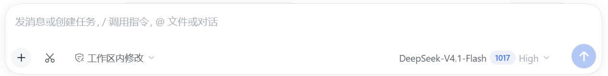

[README.md](https://github.com/user-attachments/files/33919037/README.md)
# dsh-lit-shot

在 DSH 打字框里加一个截图键 —— 像微信聊天窗里那个：点一下、框一块、图就进输入框。



- **左键点剪刀**：冻结当前屏幕 → 在整个虚拟桌面上拖一个矩形 → 松手，图片进草稿框。
- **全局热键 `Alt+A`**：在别的窗口里也能直接框选；截完自动回到 DSH，图片进草稿。
- **右键点剪刀**：看当前快捷键，按一下新的组合键就改掉（存到 `~/.dsh/dsh-lit-shot/settings.json`）。
- 插入走 DSH 自己的草稿附件通道（缩略图、数量/大小校验、随消息上传都由它负责）；输入框没准备好时退到剪贴板并提示。

## 安装

要求：**Windows 10/11**、DSH `0.2.0-rc.2` 及以上（在 `0.2.1-rc.2` 上验证过）、系统自带的 Windows PowerShell 5.1（不需要 pwsh）。

```powershell
dsh plugin add github:OWNER/dsh-lit-shot
```

也可以在 DSH 插件页里用「从路径安装」指向本仓库目录。装好后**重启 DSH**（宿主半是常驻进程，只在启动时加载）。

## 用法

| 操作 | 结果 |
| --- | --- |
| 左键点剪刀 | 冻结屏幕 → 拖框 → 图片进输入框 |
| `Alt+A`（默认） | 同上，任何窗口里都能触发 |
| 右键点剪刀 | 快捷键面板：显示当前热键，按新组合键即修改 |
| 框选时 `Esc` / 右键 | 取消这次截图 |

## 实现

- **宿主半** `index.js`：拉起一个常驻 `powershell.exe`（`scripts/agent.ps1`，内嵌 C#）。脚本用 `RegisterHotKey` 抢全局热键、用全屏无边框 `Form` 画冻结画面与选框、用 GDI `CopyFromScreen` 抓屏、按选区裁剪后把 PNG 路径写回 stdout（一行一个 JSON）。宿主把这些事件包成 6 条 `ctx.webServer` 路由：`capture` / `pending` / `shot` / `claim` / `settings` / `cancel`。
- **浏览器半** `client.js`：在 `conversation.input.left` 槽注册剪刀按钮，点它 `POST capture` 等结果；热键截的图通过 `/pending` 轮询取回。拿到 PNG 后 `conversation.createDrafts(sessionId, [file])` → `inputActions.addAttachments(ids)`，失败则回滚并把图放进剪贴板。

## 已知限制

- **仅 Windows**：截屏、全局热键、覆盖层都建立在 Win32 与 PowerShell 上。
- 覆盖层只做「框选整块屏幕」：没有贴图标注、没有滚动截长图、没有窗口吸附。
- 宿主半改动必须**重启 DSH** 才生效；浏览器半会随页面刷新热载。
- `conversation.createDrafts` / `inputActions.addAttachments` 是 DSH 尚未写进文档的草稿附件接口，升级后可能变动 —— 插件里做了失败回滚和剪贴板兜底，但这条线不是公开契约。
- `Alt+A` 可能和别的软件撞车；撞了会在右键面板显示「未注册」，换一个组合键即可。
- 第一次框选约有 1 秒冷启动（加载 PowerShell 脚本），之后常驻进程基本在 0.3 秒内出画面。

## English

A screenshot button for the DSH composer on Windows: click the scissors, drag a rectangle over the frozen screen, and the picture is handed to the shipped draft-attachment channel so it is sent as a normal image. A resident PowerShell agent owns the global hotkey (`Alt+A` by default, editable from the right-click panel) and a full-screen overlay. Requires DSH `>=0.2.0-rc.2` on Windows 10/11.

```powershell
dsh plugin add github:OWNER/dsh-lit-shot
```

## 许可证

MIT
